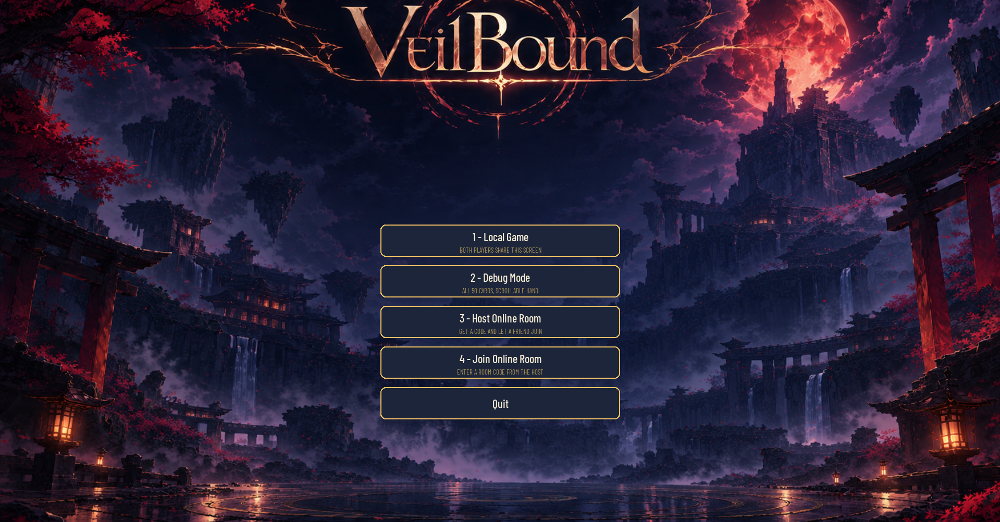

# Veilbound

> A two-player anime card dueler — outplace, out-reveal, and outscore your rival across four rows and two rounds.

   

## Screenshots

| V1.0 — Local board | V1.0 — Reveals |
|---|---|
|  |  |

| V2.0 — Main menu | V2.0 — Board update |
|---|---|
|  |  |

## The game

**Local hot-seat or online rooms.** Two players share one window, or host a six-character room code and duel over the network — same rules, animations, and sounds either way.

**How a match plays.** Alternate turns dragging cards into each row's next empty slot. Placing a card reveals the previous one in that row; the newest stays face down. Once every slot is filled, the remaining face-down cards reveal Row 1 → Row 4, then each row scores: highest revealed total wins points equal to the row's capacity, ties award nothing. Two rounds, match points carry forward.

**The roster.** 50 unique anime characters. Each player draws from an independent random 40-card pool (no duplicates within your pool), persisting across both rounds — played cards stay used, undrawn cards wait in the pile. Scoring uses base points only; effect text is flavor shown on reveals and hovers.

## Controls

| Input | Action |
|---|---|
| Drag card | Place into the row's next empty slot |
| `Esc` | Pause / resume (state and sounds preserved) |
| `F11` or `Alt+Enter` | Toggle fullscreen |
| `Tab` / `Enter` | Switch join fields / connect (online join) |

Pause offers **Options** (live SFX + music volume, 10% steps) and **Quit Game**. Offline matches (local/debug) can also return straight to the main menu.

## Customize

Add portraits under `assets/art/characters/`, then register them in `veilbound/assets/data/anime_bedriegers_bedrogen.json` (`id`, `name`, `base_points`, `effect_name`, `effect_text`, `image`). Missing art falls back to a generated placeholder. Backgrounds, animation presets, and audio live in `config/settings.json`.

## Project layout

```text
assets/              Character art, card backs, UI frames, backgrounds, sounds, fonts
config/settings.json Animation, audio, and background settings
veilbound/assets/    Character definitions (JSON)
veilbound/client/    Pygame app, assets, renderer, layout, input
veilbound/shared/    Rules engine (Pygame-free): models, engine, scoring
tests/               Gameplay, networking, and asset-loading tests
Snapshots/           Version screenshots shown above
```

## Commands

Setup (PowerShell):

```powershell
python -m venv .venv
.\.venv\Scripts\Activate.ps1
python -m pip install -r requirements.txt
```

Play locally:

```powershell
python -m veilbound.client
```

Host a room (default `127.0.0.1:8765`; `--host 0.0.0.0` for LAN):

```powershell
python -m veilbound.server
```

Join from another machine:

```powershell
python -m veilbound.client --host 192.168.1.10 --port 8765
```

Run the tests:

```powershell
python -m pytest -q
```
